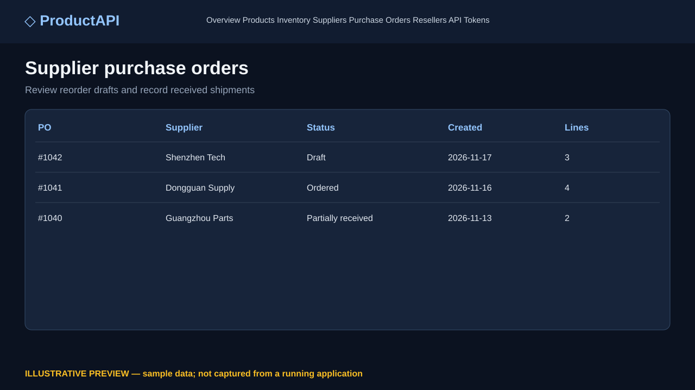

# 📦 ProductAPI

**ASP.NET Core 8 · C# · EF Core · MySQL 8 · Dark-mode admin UI**

Inventory management, reseller API tokens, supplier purchasing and stock alerts in one application.

> ⚠️ **Development starter.** The project and tests have not yet been compiled or run in the authoring environment. Review the [testing guide](TESTING.md) and GitHub Actions results before deployment.

## 🖥️ Visual previews




*These are illustrative UI mockups with sample data, not screenshots from a running application.*

## ✨ Features

| Area | Capabilities |
|---|---|
| 📦 Products | SKUs, categories, suppliers, descriptions and active status |
| 💰 Prices | Purchase, retail and reseller prices |
| 📊 Stock | Available quantity = on-hand minus reserved |
| ⚠️ Alerts | Default reorder warning at 20% of target inventory |
| 🏭 Suppliers | Supplier details and lead times |
| 🚢 Purchasing | Draft orders, placed orders, partial/final receiving |
| 🤝 Resellers | Company accounts and inventory reservations |
| 🔑 API access | Hashed tokens, scopes, expiry and revocation |
| 🖼️ Product images | Up to 20 JPEG, PNG or WebP files per product on local disk; primary image, ordering and alt text |
| 🧪 Testing | xUnit unit tests and Docker/MySQL API integration tests |

## 🚢 Supplier replenishment

1. Configure a supplier, target stock and reorder threshold for each product.
2. A low-stock warning appears when available stock is at or below the threshold.
3. Create a supplier purchase-order draft and review product quantities and unit costs.
4. Mark the purchase order as placed after contacting the supplier.
5. Record received quantities. The system updates stock and creates movement records.

**Important:** Marking an order as placed does not send email, pay a supplier or place an external order.

## 🧭 Admin routes

- `/admin` — Dashboard
- `/admin/products` — Products and categories
- `/admin/inventory` — Inventory adjustments
- `/admin/suppliers` — Supplier management
- `/admin/purchaseorders` — Purchase-order workflow
- `/admin/resellers` — Reseller accounts
- `/admin/tokens` — API tokens

## 🔌 Reseller API

```http
GET /api/v1/products
X-API-Key: pa_YOUR_TOKEN
```

Other routes: `GET /api/v1/products/{id}`, `GET /api/v1/categories`, `GET /api/v1/inventory`, `GET /api/v1/me`, `POST /api/v1/orders`, and `GET /api/v1/orders/{id}`.

Purchase prices are never returned from the reseller product API.

## ⚙️ Development setup

Install .NET 8 SDK and MySQL 8. Configure your empty `walteradmin` database via **user secrets**, not tracked files:

```bash
cd ProductAPI
dotnet user-secrets init
dotnet user-secrets set "ConnectionStrings:DefaultConnection" "Server=127.0.0.1;Database=walteradmin;Port=3306;User ID=YOUR_USER;Password=YOUR_PASSWORD;"
dotnet user-secrets set "Admin:Username" "admin"
dotnet user-secrets set "Admin:PasswordSha256" "YOUR_SHA256_PASSWORD_DIGEST"
dotnet tool install --global dotnet-ef --version 8.0.8
dotnet ef migrations add InitialCreate
dotnet ef database update
dotnet run
```

Do not use the SHA-256 admin password scheme for production; migrate to ASP.NET Core Identity with a password KDF and MFA. Migrations are not included in the repository yet. Preserve existing migration history when upgrading an installed database.

## 🧪 Tests

```bash
dotnet test ProductAPI.Tests.Unit/ProductAPI.Tests.Unit.csproj
dotnet test ProductAPI.Tests.Integration/ProductAPI.Tests.Integration.csproj
```

Integration tests use a disposable MySQL 8 container and require Docker. See **[TESTING.md](TESTING.md)** for coverage, CI, and limitations.

## 🔐 Production checklist

Before production: compile and run the full suite, review database migrations, use HTTPS, move secrets into secure configuration, replace admin password hashing, add MFA and rate limits for login, test parallel orders and receipt idempotency, and review reseller authorization and audit logging.

**Never commit the MySQL root password or reseller tokens to this public repository.**


## 🖼️ Product images (local disk)

Open **Products → Manage images** or visit `/admin/products/{id}/images`. Upload up to **20 images per product**, maximum **5 MB each**. Supported formats: JPEG, PNG, WebP. The page supports primary-image selection, ordering, alt text and deletion. The reseller product API returns `primaryImageUrl` and an `images` gallery.

Files are stored under `ProductAPI/wwwroot/uploads/products/` and image metadata is stored in the MySQL `productimage` table. **The upload folder must be writable and backed up**, and should be on a persistent volume if deploying in containers. URLs are public static assets; do not upload private images. Files are identified by generated random names. Configure a reverse-proxy request-size limit and image processing/antivirus scanning before production.

**Schema update:** After pulling the changes, run `dotnet ef migrations add AddProductImages` and `dotnet ef database update` from the `ProductAPI` directory, retaining your existing migration history. The repository does not contain generated migrations.


### 🔄 Inventory consistency update

- **Variant orders:** `POST /api/v1/orders` accepts an optional `ProductVariantId` per line. Variant orders reserve the selected variant's stock and price; base-product orders continue to use base stock. Shipping and cancellation update the same stock pool.
- **Warehouse adjustments:** Recording a bin's absolute quantity applies the difference to the corresponding product/variant total. Transfers move quantities between bins without changing totals. Shipping reduces bin counts where recorded; any remainder comes from unallocated stock.
- **Legacy inventory:** Existing product stock may not have a warehouse assignment. Review and reconcile legacy counts before adopting warehouse bin counts. Do not enter the full existing stock as a new bin adjustment without accounting for the resulting total increase.
- **Remaining gaps:** No partial shipments, returns, picking reservations by warehouse, image compression, full variant/image CSV import, or end-to-end migrations. CI must pass before deployment.

### 🧪 CI verification

The authoring environment does not have a .NET SDK or Docker. Tests have been added for variant reservations and image/variant API responses, but **no green CI run has been verified**. Check [GitHub Actions](https://github.com/1x4x/2000-product-webapi/actions) before relying on the changes.


### 🛠️ CI diagnostics

The GitHub Actions workflow saves restore, build, unit-test and integration-test console logs as artifacts even when the job fails. Review the latest workflow run's **test-results** artifact to identify any compilation or runtime failures. No passing run has been confirmed.
