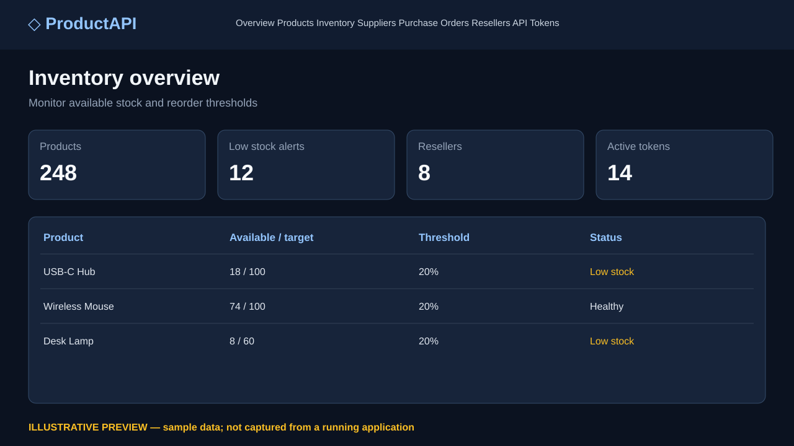
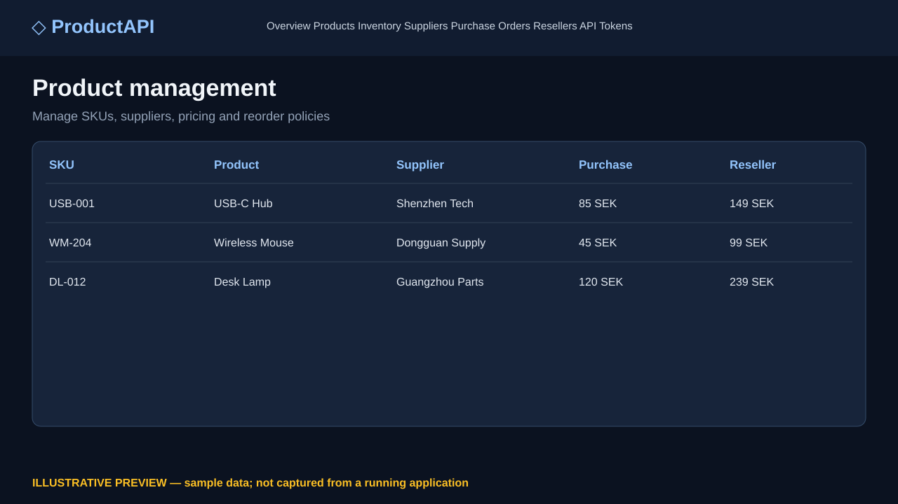

<div align="center">

# 📦 ProductAPI

### Dark-mode inventory, reseller API & supplier purchasing

**ASP.NET Core 8 · C# · Razor Pages · Entity Framework Core · MySQL 8**

   

Manage products, available stock, retailer and reseller pricing, supplier purchase orders, and API access in **one application**.

</div>

> [!IMPORTANT]
> **Development starter — not production-ready.** The application has not been compiled or integration-tested in the original creation environment. Screenshots are **illustrative SVG previews using sample data**, not captures of the running application.

## 🖥️ Dashboard



The administrator uses `/admin` and partner companies use the versioned endpoints under `/api/v1` on the same website.

## ✨ Features

| Module | Functionality |
|---|---|
| 📦 Products | Add and edit product records, SKU, descriptions, categories and supplier assignments |
| 💰 Pricing | Separate supplier purchase cost, customer retail price and reseller price |
| 📊 Inventory | On-hand inventory, reserved stock, manual stock adjustments and movement history |
| ⚠️ Low-stock alerts | Reorder warning when available stock is at or below 20% of target by default |
| 🏭 Suppliers | Manage Chinese supplier contacts, email and estimated lead times |
| 🚢 Purchase orders | Create replenishment drafts, mark orders as placed, receive partial or complete shipments |
| 🤝 Resellers | Register and activate/deactivate business partners and reserve stock for reseller orders |
| 🔑 API keys | Cryptographic tokens with assigned permissions, expiry and revocation |
| 🌙 Dark UI | Administration pages with shared dark-theme layout |

### Products and pricing



Products track `PurchasePrice`, `RetailPrice`, `ResellerPrice`, currency, `StockQuantity`, `ReservedQuantity`, `TargetStockQuantity`, `ReorderThresholdPercent` and `ReorderQuantity`.

Purchase costs are limited to the administrator pages. Reseller API responses expose only reseller/retail prices.

### Purchase orders


## 🔁 China supplier replenishment flow

1. **Track available units:** `StockQuantity - ReservedQuantity`.
2. **Detect low stock:** warn when `available × 100 <= target × thresholdPercent`. Default threshold is **20%**.
3. **Create a purchase-order draft:** select the product's assigned supplier and propose the fixed reorder quantity or enough units to restore the target.
4. **Review and place the order manually:** add or remove draft lines, review quantity and purchase price, and record the supplier order reference.
5. **Receive goods:** enter partial or full received quantities. The database transaction increases the product's stock and writes an inventory movement record.
6. **Close out:** when all items are received, the purchase order becomes `Received`.

Possible states: `Draft`, `Ordered`, `PartiallyReceived`, `Received`, `Cancelled`.

> Marking a purchase order "Ordered" changes only its internal status. The application does **not** send supplier emails, submit supplier purchases or process payments.

## 🧭 Main admin routes

| URL | Purpose |
|---|---|
| `/login` | Administrator sign in |
| `/admin` | Dashboard and stock warnings |
| `/admin/products` | Products, pricing, categories, reorder thresholds |
| `/admin/inventory` | Inventory and adjustments |
| `/admin/suppliers` | Supplier contacts and lead times |
| `/admin/purchaseorders` | Low-stock replenishment and supplier POs |
| `/admin/purchaseorders/{id}` | Review an order and record receipts |
| `/admin/resellers` | Partner accounts |
| `/admin/tokens` | API key issuance, expiry, scope and revocation |

## 🔌 Reseller API endpoints

| Method | Endpoint | Permission |
|---|---|---|
| GET | `/api/v1/products` | `products:read` |
| GET | `/api/v1/products/{id}` | `products:read` |
| GET | `/api/v1/categories` | `products:read` |
| GET | `/api/v1/inventory` | `inventory:read` |
| GET | `/api/v1/me` | `products:read` |
| POST | `/api/v1/orders` | `orders:create` |
| GET | `/api/v1/orders/{id}` | `orders:read` |

Example request:

```bash
curl -H "X-API-Key: pa_YOUR_TOKEN" https://localhost:7041/api/v1/products
```

Keep reseller keys on the reseller **server**, never in public browser JavaScript. The API checks token hash, scope, expiry, revocation and reseller activation.

## 🚀 Development setup

**Requirements:** .NET 8 SDK, MySQL 8 and dotnet-ef 8.0.8.

1. Open `ProductAPI.sln` in Visual Studio, or open a terminal at the repository root.
2. Move to the project directory: `cd ProductAPI`.
3. Configure local .NET user secrets (do not commit real credentials):

```bash
dotnet user-secrets init
dotnet user-secrets set "ConnectionStrings:DefaultConnection" "Server=127.0.0.1;Database=walteradmin;Port=3306;User ID=YOUR_DB_USER;Password=YOUR_DB_PASSWORD;"
dotnet user-secrets set "Admin:Username" "admin"
dotnet user-secrets set "Admin:PasswordSha256" "YOUR_64_CHARACTER_SHA256_HEX_DIGEST"
```

4. Generate the schema for a new **empty** `walteradmin` database:

```bash
dotnet tool install --global dotnet-ef --version 8.0.8
dotnet ef migrations add InitialCreate
dotnet ef database update
dotnet run
```

5. Open the printed HTTPS URL and go to `/login` or `/admin`.

**Migrations are not bundled.** If you applied migrations from an older starter, retain the previous migrations and generate a new upgrade migration instead of repeating `InitialCreate`. Back up the database before migrating.

## 🗂️ Repository structure

```text
ProductAPI.sln
README.md
docs/screenshots/
ProductAPI/
  Data/AppDbContext.cs
  Models/Entities.cs
  Pages/Admin/
  Pages/Shared/
  Services/ApiKeyService.cs
  Program.cs
  appsettings.json
  ProductAPI.csproj
```

## 🛡️ Security and known limitations

- **Do not deploy as-is.** Compile, exercise the migration on a disposable MySQL database and review the app before exposing it publicly.
- Replace the starter SHA-256 administrator password check with ASP.NET Core Identity or a suitable password hash scheme, and add MFA.
- Use HTTPS, strict access controls, a least-privilege database user, backups, and secure server-side secret storage.
- Admin login needs improved throttling/account protection; token restrictions still need IP allowlists and stronger audit logging.
- Product editing currently uses an existing numeric ID rather than a pre-populated edit dialog.
- Supplier email dispatch, payment, formal approvals and PDF purchase orders are not implemented.
- Harden receipt idempotency, cancellation/reservation handling, concurrency and cross-currency totals before production.
- The user-provided MySQL root password is intentionally **not included** in this public repository.

## 🧪 Acceptance checklist

- [ ] `dotnet build` succeeds
- [ ] Generate and apply EF Core migrations to an empty `walteradmin` database
- [ ] Admin sign-in and sign-out work via HTTPS
- [ ] Add and edit products, prices, categories and suppliers
- [ ] Show warning at exactly 20% available stock
- [ ] Create a low-stock reorder draft for the assigned supplier
- [ ] Record partial and final receipts without duplicate stock adjustments
- [ ] Reject expired/revoked API keys
- [ ] Prevent a reseller from seeing supplier costs or another reseller's orders
- [ ] Test concurrent orders and inventory updates

---

**ProductAPI** · Inventory visibility → Supplier replenishment → Reseller fulfillment
